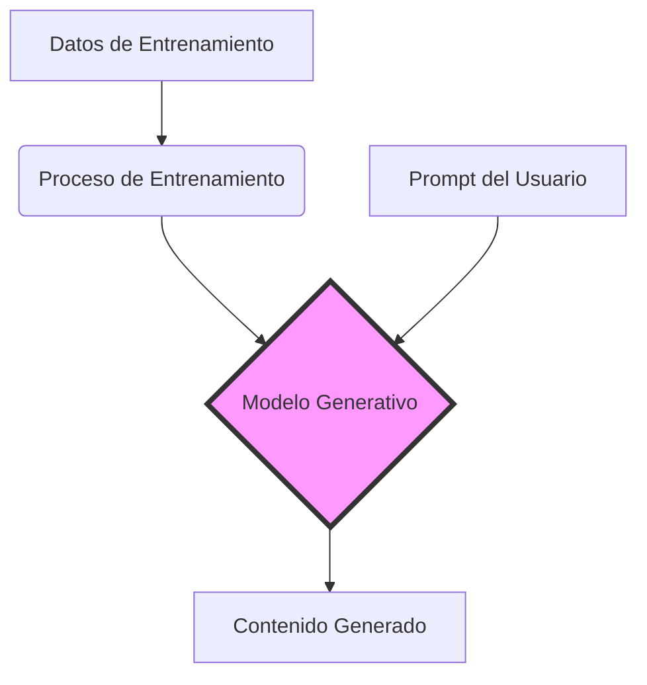
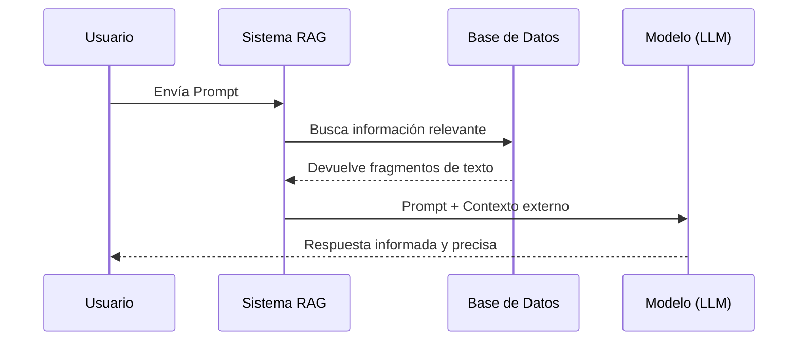

# IA Generativa (Inteligencia Artificial Generativa)

## ¿Qué es?

La **IA Generativa** es un tipo de inteligencia artificial capaz de crear contenido nuevo: texto, imágenes, audio, video, código y más. A diferencia de la IA tradicional, que solo analiza o clasifica datos existentes, la IA Generativa *produce* material original basándose en los patrones que aprendió durante su entrenamiento.

---

## ¿Cómo funciona?

La IA Generativa se entrena con grandes volúmenes de datos (textos, imágenes, etc.) y aprende los patrones, estructuras y relaciones que existen en esos datos. Cuando recibe una instrucción (llamada *prompt*), genera una respuesta nueva que sigue esos patrones aprendidos.

Los modelos más comunes son:

- **LLM (Modelos de Lenguaje de Gran Escala):** generan texto (ej. ChatGPT, Claude, Gemini).
- **Modelos de difusión:** generan imágenes (ej. DALL·E, Midjourney, Stable Diffusion).
- **Modelos multimodales:** combinan texto, imagen, audio y video.

---

## Ejemplos de uso

- **Negocios:** redacción de correos, resúmenes de reuniones, análisis de datos.
- **Educación:** explicación de conceptos, generación de ejercicios, tutoría personalizada.
- **Diseño y creatividad:** creación de imágenes, música, videos y contenido de marketing.
- **Programación:** generación y revisión de código, depuración de errores.
- **Salud:** apoyo en diagnósticos, redacción de informes clínicos.

---

## Conceptos clave

| Término           | Significado                                                  |
| ----------------- | ------------------------------------------------------------ |
| **Prompt**        | La instrucción o pregunta que se le da al modelo             |
| **Modelo**        | El sistema de IA entrenado para generar respuestas           |
| **Entrenamiento** | El proceso de aprendizaje del modelo con grandes cantidades de datos |
| **Alucinación**   | Cuando el modelo genera información incorrecta pero presentada con confianza |
| **RAG**           | Generación Aumentada por Recuperación — combina el modelo con fuentes de datos externas |
| **Fine-tuning**   | Ajuste fino del modelo para una tarea o industria específica |

---

## Ventajas y limitaciones

**Ventajas:**

- Aumenta la productividad significativamente
- Accesible para usuarios sin conocimientos técnicos
- Capaz de generar contenido de alta calidad en segundos
- Adaptable a múltiples industrias y tareas

**Limitaciones:**

- Puede generar información incorrecta (alucinaciones)
- Requiere supervisión humana para tareas críticas
- Plantea preguntas éticas sobre derechos de autor y privacidad
- El rendimiento depende de la calidad del prompt

---

## El futuro de la IA Generativa

La IA Generativa está evolucionando rápidamente hacia modelos **multimodales** (que combinan texto, voz e imágenes), **agentes autónomos** (que ejecutan tareas complejas de forma independiente) y mayor integración en herramientas cotidianas como procesadores de texto, hojas de cálculo y plataformas de comunicación.

> *"La IA Generativa no reemplaza la inteligencia humana — la amplifica."*I
