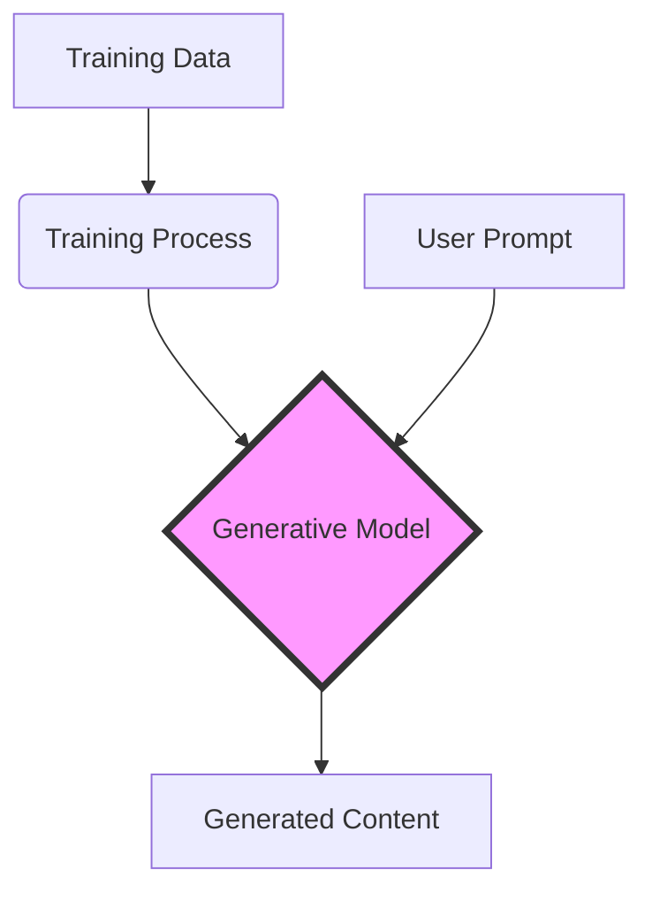
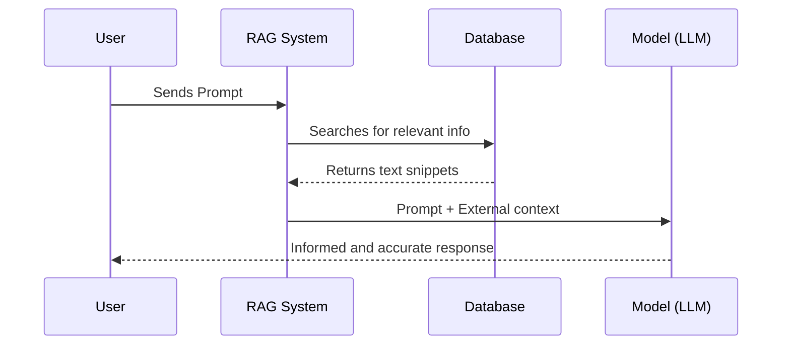

# Generative AI (Artificial Generative Intelligence)

## What is it?

**Generative AI** is a type of artificial intelligence capable of creating new content: text, images, audio, video, code, and more. Unlike traditional AI, which only analyzes or classifies existing data, Generative AI *produces* original material based on the patterns it learned during its training.

---

## How does it work?

Generative AI is trained on large volumes of data (text, images, etc.) and learns the patterns, structures, and relationships that exist within that data. When it receives an instruction (called a *prompt*), it generates a new response that follows those learned patterns.

Common models include:

- **LLMs (Large Language Models):** generate text (e.g., ChatGPT, Claude, Gemini).
- **Diffusion Models:** generate images (e.g., DALL·E, Midjourney, Stable Diffusion).
- **Multimodal Models:** combine text, image, audio, and video.

---

## Use Case Examples

- **Business:** drafting emails, meeting summaries, data analysis.
- **Education:** explaining concepts, generating exercises, personalized tutoring.
- **Design and Creativity:** creating images, music, videos, and marketing content.
- **Programming:** code generation and review, error debugging.
- **Health:** diagnostic support, drafting clinical reports.

---

## Key Concepts

| Term | Meaning |
|---|---|
| **Prompt** | The instruction or question given to the model |
| **Model** | The AI system trained to generate responses |
| **Training** | The process of the model learning from large amounts of data |
| **Hallucination** | When the model generates incorrect information but presents it confidently |
| **RAG** | Retrieval-Augmented Generation — combines the model with external data sources |
| **Fine-tuning** | Adjusting a model for a specific task or industry |

---

## Advantages and Limitations

**Advantages:**
- Significantly increases productivity
- Accessible to users without technical knowledge
- Capable of generating high-quality content in seconds
- Adaptable to multiple industries and tasks

**Limitations:**
- Can generate incorrect information (hallucinations)
- Requires human supervision for critical tasks
- Raises ethical questions about copyrights and privacy
- Performance depends on prompt quality

---

## The Future of Generative AI

Generative AI is rapidly evolving towards **multimodal** models (combining text, voice, and images), **autonomous agents** (executing complex tasks independently), and deeper integration into everyday tools like word processors, spreadsheets, and communication platforms.

> *"Generative AI does not replace human intelligence — it amplifies it."*
